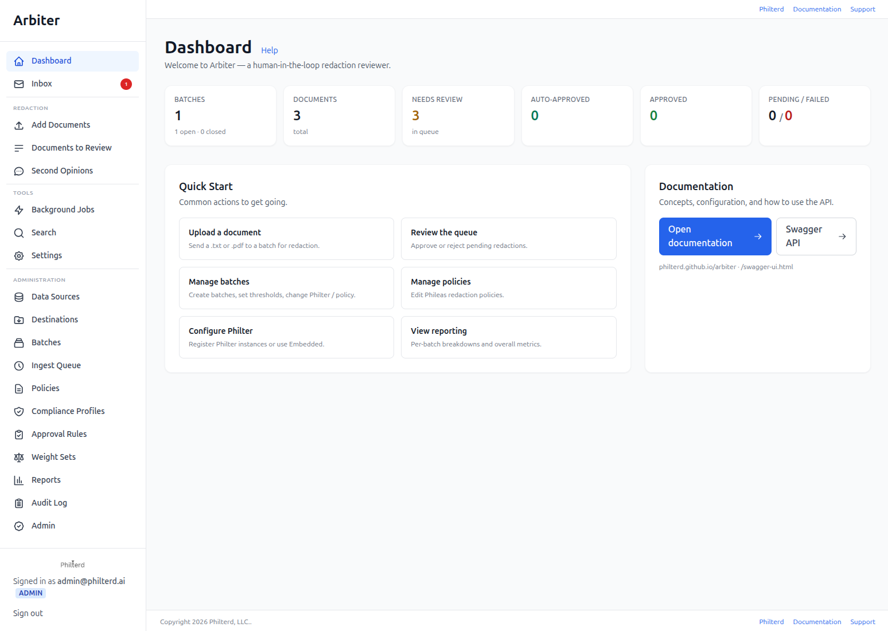

# Philter Workspace

Philter Workspace is a human-in-the-loop deidentification platform. It runs your
documents through the [Philter / Phileas](https://www.philterd.ai) PII
detector and gives reviewers a fast, focused workflow for confirming or
correcting every detection before the document leaves the redactor.

For full documentation — installation, configuration, user and admin
guides, REST API reference, and more — see
<https://philterd.github.io/philter-workspace>.

Questions, feedback, or want to contribute? [Join the Philterd Slack
workspace](https://philterd.ai/slack/) to connect with other users and
developers.



## Quick start

`quickstart.sh` builds and starts the development stack in `docker-compose.yaml`, waits
until Philter Workspace is healthy, and gives Philter's `admin` user its first password:

```shell
./quickstart.sh
```

It needs Docker with Compose v2 and `openssl`, and prints the URL and `admin`'s password
when it finishes. The first build takes several minutes. Set these to change what it does:

| Variable                  | Default     | Effect                                                     |
|---------------------------|-------------|------------------------------------------------------------|
| `PHILTER_WORKSPACE_PORT`  | `8080`      | The host port Philter Workspace is published on.           |
| `ADMIN_PASSWORD`          | generated   | `admin`'s first password, 16 characters to 72 bytes.       |
| `PHILTER_WORKSPACE_STORE` | `sqlite`    | `mongodb` to use MongoDB instead.                          |
| `OPENSEARCH_PORT`, `POLICY_EDITOR_PORT`, `MINIO_PORT`, `MINIO_CONSOLE_PORT`, `POSTGRES_PORT`, `MONGODB_PORT` | `9200`, `8081`, `9000`, `9001`, `5432`, `27017` | The host ports of the stack's other services. OpenSearch and MongoDB start only with their Compose profiles. |

Before starting anything, it checks that every host port the stack publishes is free and
names the variable that moves each one in use.

It creates `.env` with a random `PHILTER_WORKSPACE_CRYPTO_SECRET` if there is none, and can
be run again: it keeps an existing `.env` and never replaces a password `admin` already
has. Stop the stack with `docker compose down`, adding `-v` to delete its data.

### By hand

**1. Create your `.env` file with a secret key.**

Generate a cryptographically random 256-bit key:

```shell
echo "PHILTER_WORKSPACE_CRYPTO_SECRET=$(openssl rand -base64 32)" > .env
```

`PHILTER_WORKSPACE_CRYPTO_SECRET` must be a base64-encoded 32-byte value. Philter Workspace
refuses to start if it is missing, not valid base64, or does not decode to
exactly 32 bytes. `.env.example` lists the other settings `.env` can hold.

**2. Build the Docker image.**

```shell
docker compose build
```

**3. Start Philter Workspace.**

```shell
docker compose up
```

Philter Workspace will be available at <http://localhost:8080>. People sign in with
their Philter username and password; to sign in as Philter's first
administrator, `admin`, give it a password as
[First sign-in](https://philterd.github.io/philter-workspace/security/#first-sign-in) shows.

Philter Workspace sends documents to the Philter that `docker-compose.yaml` also starts,
set by `PHILTER_WORKSPACE_PHILTER_URL` and `PHILTER_WORKSPACE_PHILTER_API_KEY`. Its keys there are
for development only; for a deployment, see `docker-compose.prod.yaml` and
[Configure Philter](https://philterd.github.io/philter-workspace/workflow/#1-configure-philter).

## Building the Docker image

`build-image.sh` builds the image for `linux/amd64` and `linux/arm64`.
`push-image.sh` publishes it to
[`philterd/philter-workspace`](https://hub.docker.com/r/philterd/philter-workspace) on Docker
Hub. Both take a version as their first argument; with none, they use the
Maven project version from `pom.xml`, so an unversioned build is tagged with
what it actually contains.

```shell
./build-image.sh 1.0.0
./push-image.sh 1.0.0
```

`build-image.sh` loads each architecture under its own tag (`1.0.0-amd64`,
`1.0.0-arm64`), so both are available locally to run and test.
`push-image.sh` pushes those two tags and joins them into the `1.0.0` tag
that users pull. It builds nothing, so what is published is what was built
and tested.

Set `ARCHES` to build a single architecture:

```shell
ARCHES=amd64 ./build-image.sh
```

Pass `latest` explicitly to publish under that tag:

```shell
./build-image.sh latest
./push-image.sh latest
```

## Related Philterd open source projects

Philter Workspace is part of a wider family of open source data-privacy tools from
Philterd. The full catalog lives at
<https://www.philterd.ai/open-source-software/>.

## License

Apache License 2.0. See [`LICENSE`](LICENSE).
